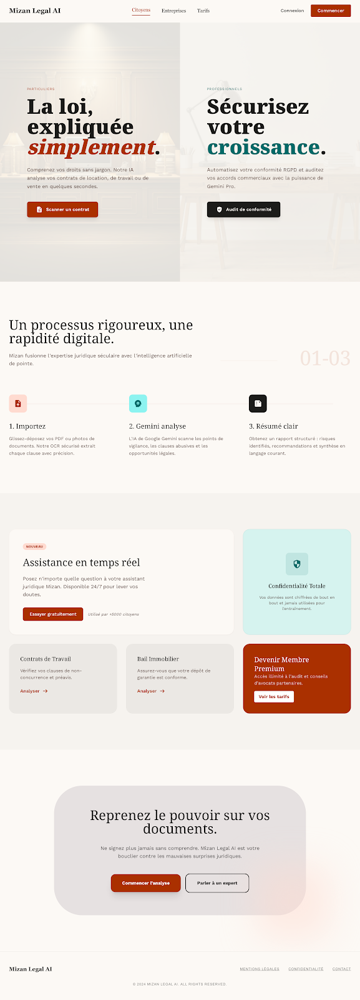

# Mizan Legal AI ⚖️

Plateforme d'assistance à l'analyse de documents juridiques, réalisée avec **Spring Boot, React, MySQL et Google Gemini**. Mizan propose des parcours pour les particuliers et les entreprises, avec une interface en français, anglais et arabe.

Projet réalisé en binôme. Ce dépôt est ma publication personnelle du projet commun, avec un nouvel historique de publication.

## Aperçu



Les maquettes et leurs sources HTML sont disponibles dans le dossier [`mizan/`](mizan/). Elles représentent les intentions de conception ; le rendu de l'application peut différer.

## Fonctionnalités

- Inscription et connexion avec authentification JWT.
- Envoi de documents à Gemini pour obtenir un résumé, des points d'attention, des droits et des étapes suggérées.
- Parcours d'analyse pour les particuliers (B2C) et les entreprises (B2B).
- Historique des analyses associé à l'utilisateur connecté.
- Assistant conversationnel et génération de brouillons de lettres.
- Export des résultats en PDF depuis le navigateur.
- Interface multilingue avec prise en charge de l'arabe et du RTL.
- Pages de présentation d'avocats et de gestion des demandes.

L'intégration IA actuelle transmet le document et les instructions à Gemini. Cette version ne contient pas de pipeline RAG avec indexation de corpus et recherche vectorielle.

## Stack technique

| Couche | Technologies |
| --- | --- |
| Interface | React 19, Vite 8, Tailwind CSS 3, React Router 7 |
| API | Java 17, Spring Boot 3.2.5, Spring Web, WebClient |
| Authentification | Spring Security, JWT, BCrypt |
| Données | MySQL, Spring Data JPA / Hibernate |
| IA | Google Gemini API |
| Rapports | html2pdf.js |

## Architecture

```text
mizan-frontend/   Application React et appels HTTP vers l'API
mizan-backend/    API REST, authentification, persistance et appels Gemini
mizan/           Maquettes, captures et prototypes HTML
```

Le navigateur appelle l'API Spring Boot, qui conserve les utilisateurs et les analyses dans MySQL. Les appels à Gemini sont effectués par le backend.

## Lancer le projet

Prérequis : **JDK 17**, **Maven 3.9+**, **Node.js 22.12+** et **MySQL 8+**, ainsi qu'une clé API Gemini.

### Backend

Définir les variables d'environnement dans le terminal qui lancera Maven. Exemple PowerShell :

```powershell
$env:DB_USERNAME = "root"
$env:DB_PASSWORD = "votre_mot_de_passe_mysql"
$env:GEMINI_API_KEY = "votre_cle_gemini"
$env:JWT_SECRET = "votre_secret_aleatoire_d_au_moins_32_octets"

cd mizan-backend
mvn spring-boot:run
```

Générer un secret JWT aléatoire avant le premier lancement, par exemple avec Node.js :

```powershell
node -e "console.log(require('crypto').randomBytes(48).toString('hex'))"
```

L'API écoute par défaut sur `http://localhost:8080`. La connexion MySQL cible `mizan_db` et demande sa création si le compte SQL en a les droits. `DB_URL` permet de remplacer l'URL JDBC complète ; `PORT` et `GEMINI_API_URL` sont également configurables.

Spring Boot lit les variables d'environnement du processus. Un fichier `.env` seul n'est pas chargé automatiquement par ce backend. Ne pas inscrire de secrets dans les sources.

### Frontend

Dans un deuxième terminal, à la racine du dépôt :

```powershell
cd mizan-frontend
Copy-Item .env.example .env.local
npm ci
npm run dev
```

Ouvrir l'adresse indiquée par Vite, généralement `http://localhost:5173`. `VITE_API_BASE_URL` désigne le backend ; cette variable est publique et ne doit contenir aucun secret.

### Vérifications

```powershell
# Dans mizan-frontend/
npm run build

# Dans mizan-backend/
mvn test
```

Pour une démonstration complète, démarrer MySQL et les deux serveurs, créer un compte, analyser un document de test, puis consulter son historique et exporter le rapport PDF.

## État du projet

Prototype de démonstration. Les réponses générées doivent être vérifiées et ne remplacent pas l'avis d'un professionnel du droit. Un déploiement public nécessite une revue de sécurité et une validation de la gestion des documents et des données personnelles. Les maquettes et les pages de présentation ne prouvent pas une intégration avec un service réel d'avocats.
